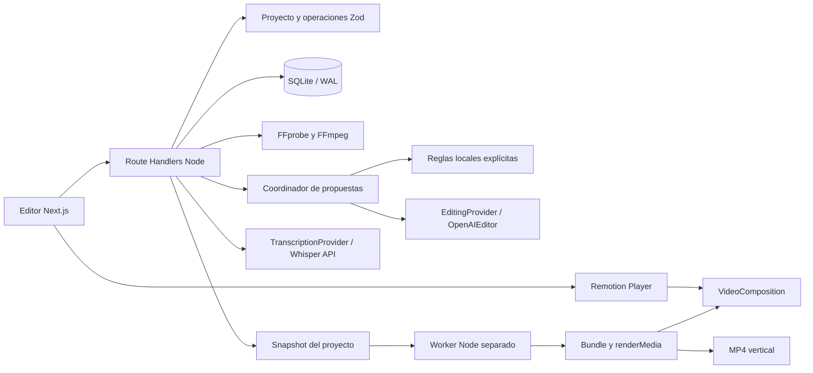

# Arquitectura de la v0.1

## Capas

- `src/domain/project.ts`: contrato versionado y validación de clips, fuentes, subtítulos, estilos, preferencias y reglas. Sin dependencias de servidor. IDs UUID; tiempos discretos a 30 fps.
- `src/domain/commands.ts`: gramática offline, operaciones declarativas `add` y `cut`, aplicación sobre una copia y validación final. No ejecuta código generado.
- `src/domain/agents.ts`: cinco responsabilidades editoriales, propuesta conservadora local y avisos. La integración de IA recibe estas responsabilidades como roles en una sola petición.
- `src/server/providers.ts`: interfaces sustituibles de transcripción y planificación. Adaptadores OpenAI con timeouts, comprobación de respuesta y validación estructural. El coordinador no dispone de visión; solo puede razonar sobre el texto suministrado.
- `src/server/store.ts`: SQLite síncrono para documentos pequeños y trabajos. WAL + busy timeout para el worker; SQL parametrizado. El guardado exige la revisión esperada y devuelve 409 si otro cliente ya la modificó.
- `src/server/media.ts`: ejecuta FFmpeg/FFprobe mediante argumentos, sin shell. Normaliza el vídeo y extrae audio cuando el usuario solicita transcripción.
- `src/remotion/VideoComposition.tsx`: plantilla parametrizada por proyecto compartida por Player y render. El bucle de clips/eventos es intencional: se edita el documento en la aplicación, no cada instancia como nodo JSX en Studio.
- `src/components/Editor.tsx`: interfaz de la v0.1, inspector, historial de sesión, propuestas y exportaciones. `EditorShell` carga el editor en el cliente.
- `scripts/render.ts`: lee la copia inmutable, compila la composición, renderiza en un proceso separado y actualiza SQLite. El servidor debe seguir sirviendo los medios durante el render. No es una cola durable de producción.

## Tiempo y cortes

`sourceFrames` identifica la longitud normalizada. Cada clip contiene `sourceStart` y `duration` en fotogramas; los clips se concatenan sin huecos. Los subtítulos mantienen `startMs/endMs` relativos a la fuente. `sourceFrameAt` transforma el fotograma de salida al de origen para resaltarlos; esto evita reescribir una transcripción al cortar.

Los eventos de motion/audio se sitúan en el tiempo de salida. Al cortar `[a,b)`, se transforma cada extremo `t` en `t - clamp(t-a,0,b-a)`. Se eliminan elementos de duración cero. El recorte manual del inspector cambia solo el clip; los efectos se corrigen manualmente si quedan fuera. La validación impide guardar/exportar un evento fuera de composición.

Cada exportación serializa un snapshot antes de iniciar el worker. Los cambios posteriores no alteran sus fotogramas. Hay un trabajo activo por proyecto; todavía no existe un límite global, cancelación, reintentos ni reparto entre equipos. Los procesos interrumpidos se detectan al consultar trabajos con PID; no se reanudan automáticamente.

## API local

| Ruta                                | Uso                                                  |
| ----------------------------------- | ---------------------------------------------------- |
| `GET/POST /api/projects`            | Listar / crear vacío o demo                          |
| `GET/PUT /api/projects/:id`         | Cargar / guardar documento con revisión              |
| `POST /api/upload`                  | Cuerpo binario MP4/MOV; `X-File-Name` codificado URI |
| `GET /api/media/:id`                | Fuente normalizada con rangos HTTP                   |
| `POST /api/projects/:id/commands`   | `{text,mode:local\|api,revision}`                    |
| `POST /api/projects/:id/plan`       | Proponer o aplicar operaciones revisadas             |
| `POST /api/projects/:id/transcribe` | `{revision}`; transcripción API explícita            |
| `POST /api/projects/:id/export`     | `{revision}`; devuelve ID del trabajo                |
| `GET /api/jobs/:id`                 | Estado y progreso                                    |
| `GET /api/jobs/:id?download=1`      | MP4 completado                                       |

JSON de mutación limitado a 4 MB; vídeo a 250 MB por streaming. Se comprueba Origin cuando está presente y se rechazan peticiones cross-site. No se aceptan URLs arbitrarias de medios en el documento. Los medios se resuelven por UUID a archivos internos. No son controles de autenticación: esta aplicación se ejecuta en un equipo de confianza, en loopback.

## Estilos, recursos y referencias

`styles` define perfiles reutilizables y sus directrices. Las reglas de cada proyecto se conservan en SQLite y llegan al proveedor. El intérprete local y la revisión local no aprenden ni interpretan reglas libres. El catálogo de recursos incluye tipo, ruta y licencia; el MVP implementa sonido y motion de código.

`ReferenceAnalysis` es solo un contrato de extensión, no un extractor. Una futura fase debe añadir referencia con procedencia/consentimiento, características temporales, ritmo de cortes, color/tipografía y reglas sugeridas revisables. No se deben importar automáticamente activos propietarios. La ampliación debe añadir una migración del documento si cambia su semántica y pruebas de compatibilidad con proyectos existentes.
